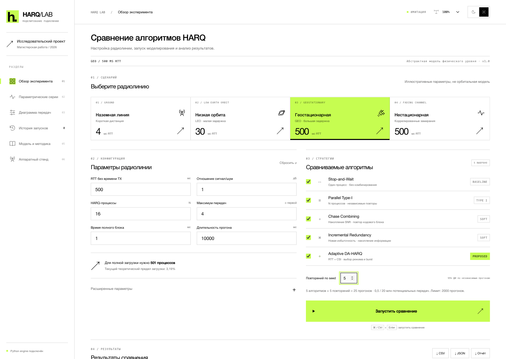
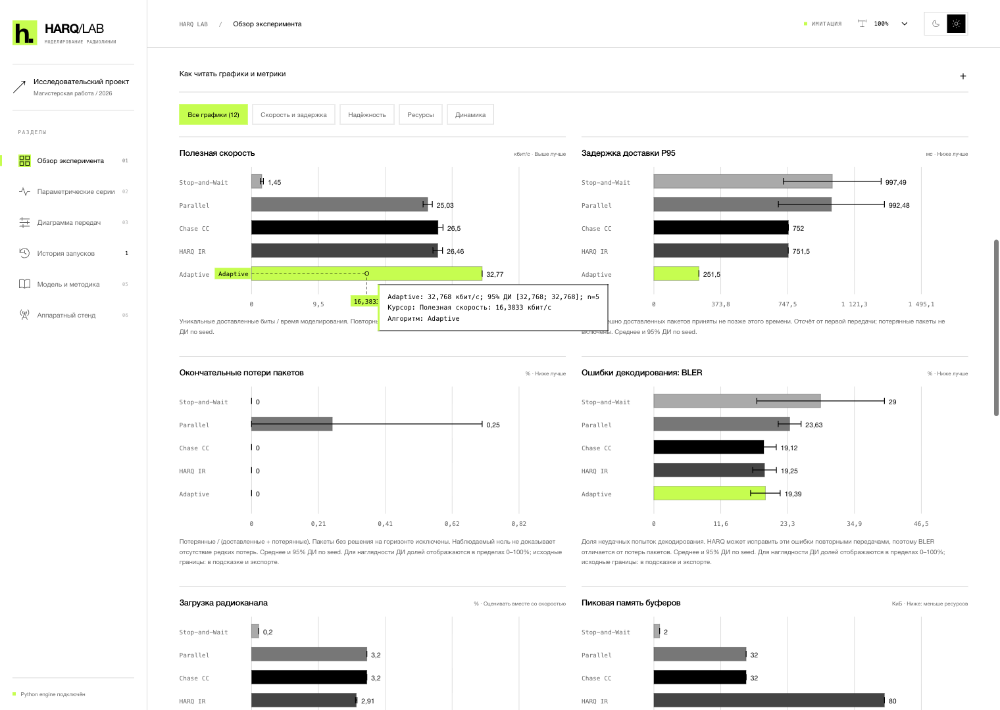
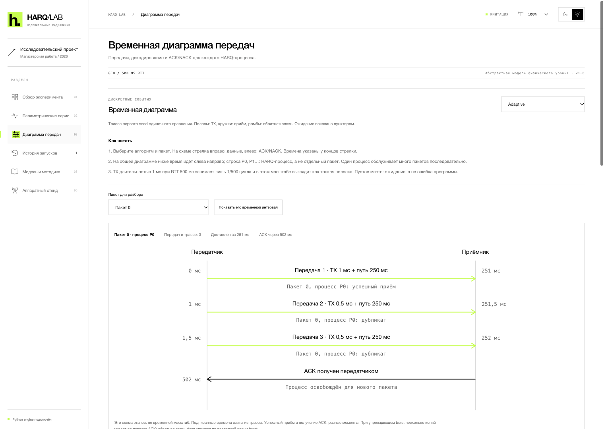
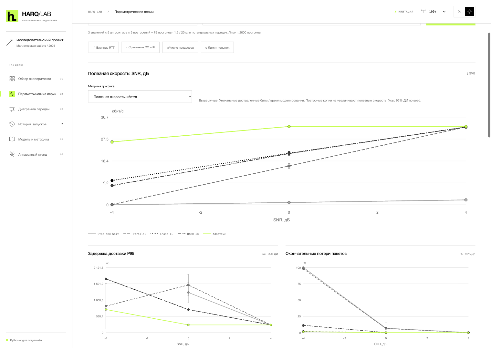
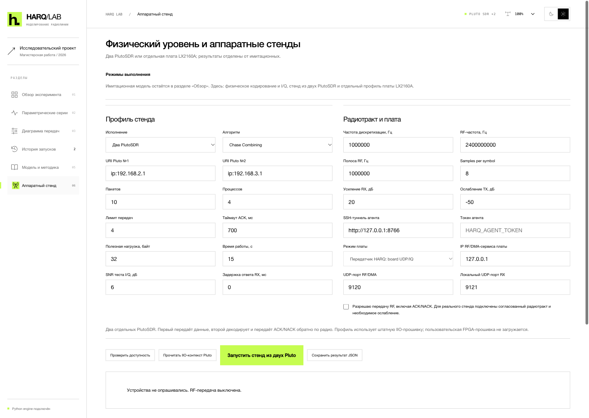
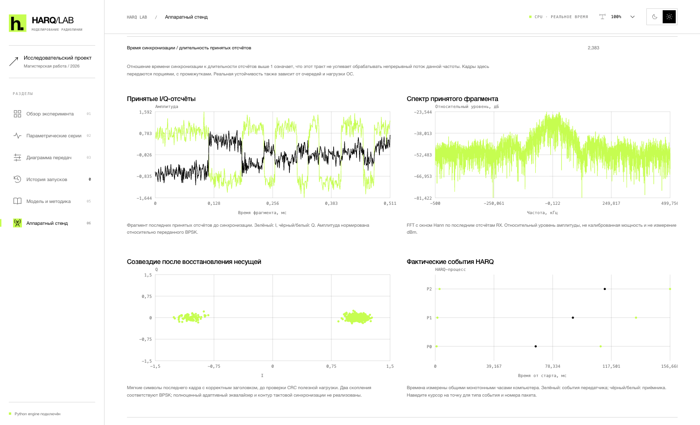

# HARQ Lab

Настольная исследовательская лаборатория по теме **«Разработка и исследование алгоритмов HARQ-ретрансмиссий для радиолинии с большим временем распространения»**.

Проект объединяет дискретно-событийный симулятор на Python, анализ экспериментальных серий и интерфейс Electron. Отдельный физический I/Q-стенд позволяет исследовать передачу кодированных битов и готовить эксперименты с двумя PlutoSDR либо платой на LX2160A.

[Быстрый старт](#быстрый-старт) · [Инструкция](#работа-с-приложением) · [Сборка](docs/BUILD.md) · [Методика](docs/METHODOLOGY.md) · [Стенд CPU](docs/REALTIME.md) · [Оборудование](docs/HARDWARE.md)



## Научная значимость

При большом времени распространения ожидание ACK/NACK ограничивает загрузку радиоканала: даже при успешном декодировании передатчику может не хватать свободных HARQ-процессов. Повышение числа процессов и упреждающие передачи уменьшают простой, но требуют памяти и дополнительных радиоресурсов. Проект предназначен для количественного исследования этого компромисса.

**Цель исследования:** определить, как RTT, качество канала, число HARQ-процессов, лимит повторов, дедлайны и объём мягких буферов влияют на полезную скорость, надёжность и задержку доставки.

Исследовательская ценность реализации:

- Единая временная модель и одинаковая скорость передачи символов позволяют сравнивать стратегии при явно заданном бюджете радиоресурсов.
- Исследуемая эвристика **Adaptive Delay-Aware HARQ** выбирает CC/IR, длину упреждающего burst, лимит передач и число процессов с учётом задержки, памяти и целевого уровня потерь. Оценка канала обновляется по задержанной обратной связи.
- Независимые репликации, 95% доверительные интервалы и парное сравнение Adaptive с Parallel позволяют оценивать неопределённость результатов, а не судить по одному прогону.
- Сохранение конфигурации, seed, сырых метрик и параметров среды обеспечивает воспроизводимость вычислительных экспериментов.
- Разделение сетевого симулятора и битового PHY-стенда позволяет проверять протокольные гипотезы отдельно от конкретного радиотракта.

Для безошибочного канала и фиксированной длительности передачи модель проверяется по аналитическому пределу загрузки:

$$\eta = \min\left(1,\frac{N T_{slot}}{RTT + T_{slot}}\right).$$

Здесь $N$ обозначает число процессов, а `RTT` включает распространение и обработку, но не эфирное время. Например, при `RTT = 500 мс`, `T_slot = 1 мс` и `N = 16` предел равен примерно **3,19%**.

Adaptive является исследуемой эвристикой: её оптимальность, универсальное превосходство и достижение заданного уровня потерь не предполагаются. Научная новизна и область применимости должны подтверждаться абляциями, независимыми экспериментами и калибровкой модели. Допущения и определения: [методика исследования](docs/METHODOLOGY.md).

## Возможности

| Область | Реализация |
|---|---|
| Протокол | Параллельные HARQ-процессы, ACK/NACK, таймауты, дедлайны, потеря обратной связи |
| Канал | AWGN, независимый и коррелированный Rayleigh, lognormal shadowing |
| Ресурсы | Общий ресурс передачи, переменная длительность IR-повторов, ограничения мягких буферов |
| Эксперименты | Сравнения и параметрические серии по независимым seed, 95% ДИ, отмена расчёта |
| Метрики | Goodput, BLER, потери, средняя/P95 задержка, загрузка, память, передачи и символы на доставленный бит |
| Визуализация | 12 графиков сравнения, 8 метрик серий, временная диаграмма и разбор пакета |
| Данные | История SQLite, экспорт JSON/CSV/Markdown, исследовательские PNG/SVG через CLI |
| Интерфейс | Светлая и тёмная темы, масштаб 85–130%, подсказки, координаты и перекрестие |

Сравниваются пять конфигураций:

| Стратегия | Особенности |
|---|---|
| Stop-and-Wait Type-I | Один процесс, независимое декодирование каждой попытки |
| Parallel Type-I | Несколько процессов без накопления наблюдений |
| Chase Combining | Параллельные процессы с накоплением SNR повторов |
| Incremental Redundancy | Параллельные процессы с накоплением дополнительной избыточности |
| Adaptive Delay-Aware HARQ | Адаптивный выбор режима накопления, burst и ресурсных ограничений |

## Скриншоты

На скриншотах показано работающее приложение в светлой теме. Графики построены по результатам расчётов; экран аппаратного профиля показывает настройку стенда, а не подтверждение подключения оборудования.

### Сравнение алгоритмов

Подсказка содержит значение наблюдения и доверительный интервал. Перекрестие показывает координаты курсора независимо от значения столбца.



### Диаграмма передач

Разбор пакета показывает передачи данных и обратную связь между узлами. Под ним доступна общая временная диаграмма HARQ-процессов.



### Параметрические серии

Изменение SNR, RTT и других параметров позволяет исследовать поведение алгоритмов на диапазоне условий.



### Аппаратный стенд

Профили двух PlutoSDR и платы LX2160A выбираются отдельно. Индикатор в шапке отражает выбранный режим.



## Быстрый старт

### Требования

- Python **3.11+**; для воспроизводимого рабочего окружения используется **3.12**.
- [uv](https://docs.astral.sh/uv/) для установки Python-зависимостей.
- Node.js **22+** и npm для Electron.
- Для аппаратных запусков: соответствующее оборудование и драйверы из [инструкции стенда](docs/HARDWARE.md).

```sh
git clone https://github.com/NLyapin/Delay-Aware-HARQ.git
cd Delay-Aware-HARQ
uv sync --python 3.12 --extra dev --locked
npm ci
npm start
```

Electron самостоятельно запускает Python API на свободном локальном порту. Расчёты выполняются на компьютере пользователя; отдельно поднимать сервер не требуется.

Для запуска интерфейса в браузере:

```sh
uv run harq-lab serve --port 8765
```

Откройте **http://127.0.0.1:8765**. Для CLI и браузерного режима Node.js не нужен; он требуется настольному приложению и его сборке.

## Работа с приложением

1. В разделе **«Обзор эксперимента»** выберите пресет либо задайте RTT, SNR, число процессов, длительность, лимит передач и ограничения ресурсов. Пресеты наземной линии, LEO и GEO иллюстративны: орбитальная геометрия не рассчитывается.
2. Выберите алгоритмы, число независимых повторений и seed. Перед запуском проверьте число прогонов и оценку бюджета. Сервер допускает до 2000 прогонов и 20 млн потенциальных передач на эксперимент.
3. Запустите сравнение. Анализируйте полезную скорость вместе с задержкой, потерями, ресурсной стоимостью и доверительными интервалами. Незавершённые пакеты учитываются отдельно от потерянных.
4. В **«Параметрических сериях»** выберите изменяемый параметр и значения через запятую. Один и тот же набор алгоритмов выполняется в каждой точке серии.
5. В **«Диаграмме передач»** выберите алгоритм и пакет. Схема пакета показывает порядок этапов и реальные отметки событий; расстояния на ней не соответствуют масштабу времени. Общая диаграмма показывает время по X и процессы по Y. [Как читать диаграмму](docs/TIMELINE.md).
6. Сохраните результаты через экспорт. Завершённые расчёты доступны в **«Истории запусков»**.

Наведение на график показывает координаты и перекрестие, на наблюдение или событие: подробности. `Escape` скрывает подсказку. `⌘ Enter` / `Ctrl Enter` запускает сравнение или серию в текущем разделе. Тема и масштаб сохраняются между запусками.

CDF задержки строится по первому seed; временные кривые усредняются по seed. P95 учитывает только успешно доставленные пакеты. Эти ограничения нужно учитывать при интерпретации графиков.

## Эксперименты через CLI

```sh
# Одиночный воспроизводимый прогон
uv run harq-lab simulate --algorithm adaptive --output results/simulation.json

# Сравнение алгоритмов из JSON-конфигурации
uv run harq-lab experiment configs/geo_comparison.json --output results/geo_comparison

# Параметрическая серия по SNR
uv run harq-lab experiment configs/snr_sweep.json --output results/snr_sweep

# Битовый PHY-эксперимент без RF-оборудования
uv run harq-lab phy --snr -1 --blocks 100 --output results/phy-validation.json

# Все восемь подготовленных исследовательских сценариев и PHY-проверка
sh scripts/run-study.sh
```

Конфигурации находятся в [configs](configs). Команда `experiment` сохраняет `experiment.json`, `runs.csv`, `report.md`, `comparison.png` и `comparison.svg`. JSON содержит параметры, сырые прогоны, статистику и сведения о среде. Каталог `results/` генерируется локально и исключён из Git.

## Стенд реального времени на компьютере

В разделе «Аппаратный стенд» выберите **«Стенд CPU реального времени»**. TX, RX и программный I/Q-канал запускаются в трёх отдельных процессах. Передаются настоящие complex64-отсчёты через сокеты ОС; ошибки определяются синхронизацией, Витерби и CRC. ACK/NACK также кодируются и проходят обратный I/Q-тракт.

```sh
uv run harq-lab hardware configs/realtime_iq.json --output results/realtime_iq.json
```

Доступны задержка распространения, джиттер, смещение несущей и частоты отсчётов, эхо и ограничение очереди. Интерфейс показывает CPU-время, PID, пик RSS на поддерживаемых ОС, опоздания и переполнения, I/Q, спектр, созвездие и фактические события HARQ. Радиосреда остаётся программной: это измерение работы CPU-модема, а не RF-канала. [Устройство стенда, метрики и ограничения](docs/REALTIME.md).



## Физический уровень и оборудование

| Режим | Назначение и текущий статус |
|---|---|
| Имитационная модель | Дискретно-событийное сравнение стратегий с абстрактным декодированием |
| CPU реального времени | Три процесса, темп выдачи отсчётов по часам хоста, измеренные задержки и загрузка; канал программный |
| Программный I/Q | Передача реальных кодированных битов через программный канал, без RF-оборудования |
| Два PlutoSDR | Реализован адаптер pyadi-iio/libiio для двух устройств; требуется подготовленный радиостенд, аппаратная проверка проекта не выполнена |
| Плата LX2160A | Реализованы Linux-агент и хостовая сторона UDP/IQ-контракта; RF/DMA-сервис зависит от конкретной платы и радиомодуля |

Физический стенд включает BPSK, синхронизацию, CRC-16, свёрточный код K=3 (7,5), puncturing, мягкое декодирование Витерби и CC/IR. ACK/NACK передаются отдельными физическими кадрами.

```sh
# Программный физический тест без радиоизлучения
uv run harq-lab hardware configs/hardware_iq.json --output results/hardware-iq.json

# Дополнительные зависимости для работы с PlutoSDR
uv sync --python 3.12 --extra dev --extra hardware --locked
```

Настройка адресов устройств, разрешение TX, запуск стенда и агента описаны в [HARDWARE.md](docs/HARDWARE.md). Индикатор профиля не является индикатором подключения. В `fpga/` находится эталонный HARQ-таймер SystemVerilog; готовый FPGA-bitstream для Pluto/LX2160A не поставляется.

## Сборка приложения

```sh
npm ci
npm run dist
```

Эта команда создаёт **оболочку Electron** в `desktop/dist/`. Python в неё не включён: при запуске такой сборки нужно задать `HARQ_PYTHON` с абсолютным путём к интерпретатору, в окружении которого установлен проект.

**Автономная сборка** дополнительно содержит Python-движок и его зависимости в `resources/backend/`. Для пользователя такой сборки отдельная установка Python не требуется. Нативные сборки создаются на соответствующих ОС: macOS, Windows и Linux.

[Полная инструкция сборки](docs/BUILD.md) содержит команды упаковки движка, конфигурацию electron-builder и форматы дистрибутивов. Локальная автоматизация сборки и публикации релизов намеренно исключена из репозитория. Подпись и нотариализация требуют собственных настроек сборочной среды.

Для автоматического выпуска предусмотрен [workflow GitHub Actions](.github/workflows/release.yml): Windows x64, Linux x64, macOS ARM64 и macOS Intel. После проверок всех четырёх целей он публикует релиз с восемью дистрибутивами и SHA-256. Локальный скрипт запуска, очистки предыдущих сборок и скачивания результатов остаётся в игнорируемой папке `.local/`. [Порядок выпуска](docs/BUILD.md#публикация-релизов-через-github-actions).

Иконка приложения использует точный квадратный знак `h.` из интерфейса и скруглённое обрамление. Для обновления её PNG/ICNS/ICO:

```sh
npx playwright install chromium
npm run build:icons
```

На macOS знак захватывается из HTML/CSS; на остальных ОС используется сохранённое изображение, чтобы подстановка шрифта не меняла форму букв. Интерфейс остаётся квадратным.

## Проверки

```sh
uv run pytest -q
uv run ruff check harq_lab tests
npm run check
npm run test:charts
npm run test:ui
```

Python-тесты проверяют модель, статистику, API и PHY. Playwright запускает настоящий Electron вместе с Python и проверяет расчёты, трассы, аппаратные профили, темы, масштабирование и интерактивные графики. Для проверки RTL-таймера нужен Icarus Verilog (`iverilog` и `vvp`). CI описан в [.github/workflows/test.yml](.github/workflows/test.yml).

## Структура проекта

```text
harq_lab/            Python: модель, стратегии, эксперименты, API, CLI
  hardware/          I/Q-стенд, PlutoSDR, агент и контракт платы
desktop/            Electron, интерфейс и иконки
configs/            Конфигурации воспроизводимых экспериментов
fpga/               Эталонный HARQ-таймер и тестовый стенд RTL
tests/              Проверки Python, графиков и Electron
docs/               Методика, инструкции и скриншоты
scripts/            Запуск исследования и вспомогательные команды
results/            Локальные данные расчётов, не включаются в Git
```

## Хранение данных

В Electron история хранится в SQLite внутри каталога `userData` приложения. CLI и браузерный сервер по умолчанию используют `results/harq.sqlite3`.

| Переменная | Назначение |
|---|---|
| `HARQ_PYTHON` | Абсолютный путь к внешнему Python; также позволяет переопределить встроенный движок |
| `HARQ_DB` | Путь SQLite для CLI и браузерного сервера |
| `HARQ_USER_DATA` | Отдельный профиль Electron: настройки, история и база |

API слушает только `127.0.0.1`. Electron использует случайный токен, ограниченный IPC-мост, `contextIsolation` и sandbox. После установки зависимостей моделирование работает локально.

## Ограничения исследования

Сетевой симулятор использует иллюстративную BLER-кривую и абстрактное накопление информации. Она не является измеренной характеристикой выбранной MCS. Полноценные NR LDPC и калиброванный PHY стандартов связи не реализованы.

Выигрыш одной конфигурации не доказывает превосходство алгоритма на всём диапазоне условий. Нулевые наблюдаемые потери не гарантируют надёжность, а малое число seed ограничивает точность статистических выводов. Для переноса результатов на реальную радиолинию нужны калибровка и аппаратные измерения.
