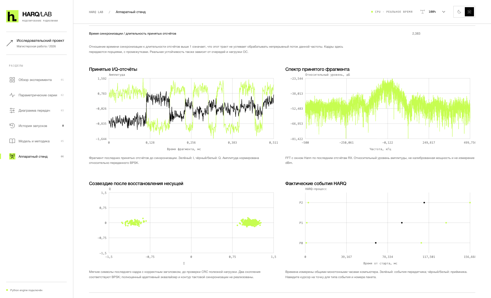

# Стенд CPU реального времени

Режим `realtime_iq` предназначен для компьютера без SDR. Он выполняет настоящий программный тракт кодированных битов, синхронизации и HARQ с измерением времени исполнения. Среда распространения остаётся программной: это не RF-измерение, не запись АЦП и не система жёсткого реального времени.

## Запуск

```sh
uv sync --python 3.12 --extra dev --locked
npm ci
npm start
```

Откройте **«Аппаратный стенд» → «Стенд CPU реального времени»**. Этот профиль выбран по умолчанию в данном разделе. Нажмите **«Запустить стенд CPU»**. Разрешение RF-передачи и радиооборудование не требуются.

Начальные настройки: 10 пакетов по 32 байта, Chase Combining, 4 процесса HARQ, 1 Мотсчёт/с, 8 отсчётов на символ, SNR 6 дБ, распространение 250 мс в каждую сторону. Таймаут ACK 2000 мс оставляет время не только на путь, но и на фактическое DSP и очереди. Профиль можно настроить вручную и сохранить результат в JSON.

CLI использует тот же движок:

```sh
uv run harq-lab hardware configs/realtime_iq.json --output results/realtime_iq.json
```

Старт трёх интерпретаторов занимает отдельное время. При отмене или ошибке дочерние процессы останавливаются и собираются родительским процессом; нельзя считать принудительно прерванный запуск завершённым экспериментом.



На скриншоте: короткий запуск с SNR 20 дБ, тремя пакетами и задержкой распространения 30 мс в одну сторону. Это иллюстрация диагностики, не оценка предельной производительности компьютера.

## Что действительно исполняется

| Участник | Работа |
|---|---|
| TX, отдельный PID | Формирует случайные полезные данные, CRC, свёрточное кодирование, puncturing и BPSK; ведёт процессы HARQ и таймеры |
| Программный канал, отдельный PID | Получает complex64 через сокеты ОС, добавляет искажения на уровне отсчётов, выдаёт порции по монотонным часам и ограничивает очередь |
| RX, отдельный PID | Ищет преамбулу, восстанавливает несущую, получает LLR, накапливает CC/IR, декодирует Витерби и проверяет CRC |
| Обратный тракт | RX кодирует ACK/NACK как BPSK-кадр; тот проходит тот же транспорт отсчётов, искажения и синхронизацию на TX |

Успех пакета не разыгрывается по вероятностной BLER-кривой. Если заголовок не удалось захватить и проверить, RX не выдумывает NACK: отправитель дожидается таймаута. NACK формируется только после распознавания заголовка и неуспешного CRC полезной нагрузки. Повторный приём уже доставленного пакета вызывает повторный ACK без повторной доставки.

Поддерживаются Stop-and-Wait Type-I, Parallel Type-I, Chase Combining и Incremental Redundancy. Адаптивная эвристика абстрактной сетевой модели сюда не переносится автоматически.

## Программная среда распространения

Прямое и обратное направления имеют независимые очереди и состояния шума: реализована дуплексная программная линия. В канале нет доступа к CRC, типу ACK/NACK или декодированным данным.

- **Темп выдачи:** определяется числом отсчётов и `sample_rate`. Выдача разбита на порции `iq_chunk_samples`; это не мгновенное копирование всего пакета при наступлении виртуального события.
- **Распространение:** `propagation_ms` задаёт задержку одного направления. ACK также проходит обратную задержку. Эфирное время, кодирование, DSP, IPC и очереди добавляются к ней.
- **Джиттер:** добавляется равномерная задержка от 0 до `jitter_ms` на burst. Порядок отсчётов одного направления сохраняется; соседние burst не перемешиваются.
- **AWGN:** шум добавляется к комплексным отсчётам. `snr_db` означает Es/N0 на символьной скорости; дисперсия на отсчёт учитывает `samples_per_symbol`.
- **Сдвиг несущей:** `carrier_offset_hz` вращает комплексный сигнал; начальная фаза неизвестна приёмнику.
- **Ошибка частоты отсчётов:** `clock_offset_ppm` меняет сетку отсчётов линейной интерполяцией. Длина принятого burst может отличаться от длины отправленного.
- **Двухлучевой тракт:** ненулевая `echo_delay_samples` добавляет задержанную комплексную копию с уровнем `echo_gain_db`; нулевая задержка отключает эхо.
- **Ограниченная очередь:** `iq_queue_samples` задаёт вместимость одного направления в эквиваленте payload-отсчётов без заголовков IPC. Если очередь заполнена, порция отсчётов теряется и это учитывается в метрике `overflow_samples`. Это потеря из-за ограниченного буфера, а не случайное решение о судьбе пакета.

Программный канал выдаёт burst-I/Q с промежутками. Он не генерирует непрерывный фон отсчётов во время простоя. Фаза модели несущей продолжается по переданным отсчётам, а не по всем тактам непрерывного АЦП. Прямоугольный BPSK-импульс и упрощённое эхо не заменяют измеренную импульсную характеристику радиолинии.

## Как читать результат

**Подтверждённая скорость**: полезные биты пакетов, для которых TX получил ACK, делённые на длительность работы TX. **Уникальные доставки RX** отдельно показывают, сколько пакетов действительно прошло CRC у приёмника. Отсутствие ACK не доказывает потерю полезной нагрузки: могла потеряться обратная связь.

**P95 создание пакета → ACK** включает формирование первого сигнала, все повторные передачи, обработку, очереди и обратный тракт. Это не оценка чистого RTT распространения. Событие `ACK.rtt_host_ms` показывает время от отправки текущей попытки в IPC до обработки ACK. Точки TX и RX в общей диаграмме используют одну монотонную шкалу времени хоста.

**CPU, % одного ядра** рассчитывается как CPU-время процесса / прошедшее время. Пик RSS, если доступен в ОС, включает интерпретатор и библиотеки; он отличается от памяти мягких буферов. На Windows пик RSS в этой реализации не измеряется и показывается как «н/д».

**Опоздание выдачи I/Q** измеряет разницу между запланированным временем порции и её передачей из расписания канала в очередь сокета. Оно не включает последующее время ожидания в сокете и DSP. Эти задержки входят в фактические времена RX и ACK.

**Время синхронизации / длительность отсчётов** сравнивает суммарное wall-clock время вызовов синхронизатора с `rx_samples / sample_rate`. Значение выше 1 означает, что в этом запуске тракт не успевал бы обрабатывать непрерывный поток данной частоты. Успешный burst-тест сам по себе не доказывает непрерывную пропускную способность 1 Мотсчёт/с.

Графики показывают реальные данные текущего запуска:

1. Последние I/Q-отсчёты до синхронизации.
2. FFT с окном Hann: относительный амплитудный спектр, не dBm и не калиброванная PSD.
3. Символы последнего кадра с корректным заголовком после восстановления несущей. Наличие созвездия не гарантирует корректный CRC полезной нагрузки.
4. События HARQ по часам хоста с пакетами, процессами и попытками в подсказках.

Экспорт JSON сохраняет конфигурацию, события TX/RX, PID и CPU-время каждого участника, диагностические метрики, фрагмент I/Q, спектр и символы. Метки `source = cpu_realtime_iq` и `hardware_verified_by_developer = false` отличают такой запуск от измерений оборудования.

## Проверочные эксперименты

- Начните с SNR 20 дБ и умеренных искажений: должны появиться уникальные доставки RX и кадры ACK.
- Снизьте SNR: наблюдайте ошибки заголовков, CRC, повторные передачи и реальные таймауты.
- Увеличьте распространение без увеличения таймаута: наблюдайте повторные и устаревшие кадры.
- Уменьшите очередь до 8192 отсчётов при большой полезной нагрузке: проверьте счётчик переполнения.
- Сравните режимы при одинаковой конфигурации и нескольких seed; сохраните сведения о машине и фоновой нагрузке.

Seed определяет генерацию полезных битов и шума, но **не делает wall-clock эксперимент детерминированным**. ОС, планировщик и загрузка CPU меняют времена обработки, заполнение буферов и иногда число повторов. Статистику этого стенда нельзя смешивать с результатами быстрого дискретно-событийного симулятора.

## Границы реализма

Радиопередачи через антенну, АЦП/ЦАП, аппаратных меток времени, реального АРУ, RRC-фильтра, полноценного эквалайзера и контура тактовой синхронизации здесь нет. При больших ошибках частоты отсчётов или сильном эхо приём может нарушаться. Непрерывный Doppler/fading-процесс и атмосферный канал не реализованы.

Стенд позволяет измерять реальную работу программного модема и протокола на данном компьютере. Для переноса выводов на физическую радиолинию требуются SDR, калибровка и аппаратные измерения. Быстрый симулятор и эталонный I/Q-тест сохранены как независимые режимы.
